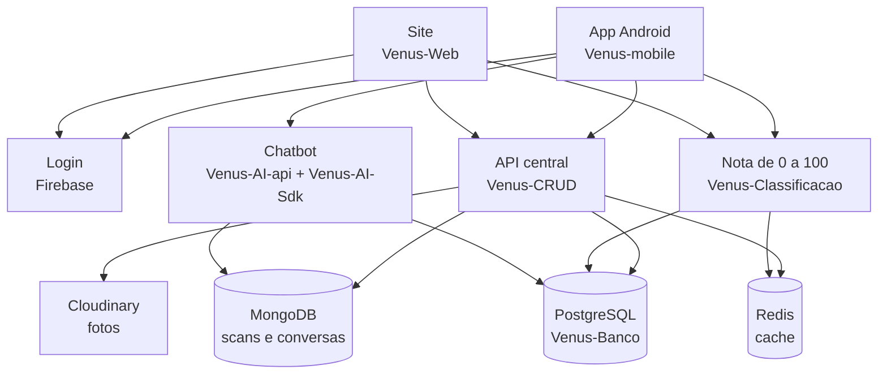

  

  
  
  
  
  
  
  
  
  
  

## Quem somos

O Venus é um projeto acadêmico desenvolvido por estudantes do Instituto J&F Germinare Tech, sem finalidade comercial. Não vendemos nada, não veiculamos publicidade e não comercializamos dados.

O Venus lê a lista de ingredientes de um cosmético e explica, em português simples, o que cada ingrediente faz para a sua pele, para o meio ambiente e para quem produz. Quando você preenche um perfil, a análise passa a considerar as suas características.

## Como funciona

<b>1. Você monta o seu perfil</b>

 

No primeiro acesso você responde um questionário sobre a sua pele e o seu cabelo: tipo de pele, acne, rosácea, eczema, manchas, melasma e couro cabeludo. Também conta se está gestante ou amamentando, quais alergias tem e o que prefere evitar (por exemplo, produto vegano, cruelty-free, sem parabeno, sem sulfato ou sem silicone). É esse perfil que deixa a análise pessoal.

<b>2. Você escaneia o produto (OCR)</b>

 

No app, você tira duas fotos: o verso, onde está a lista de ingredientes, e a frente, onde estão a marca e o nome. Antes de ler, o app confere se a foto não está tremida, escura demais ou clara demais. O texto das fotos é lido no próprio celular com OCR (ML Kit, do Google), e o app separa os ingredientes do resto do rótulo.

Com a marca e o nome, o app procura o produto no nosso catálogo. Se achou, a análise abre na hora. Se não achou, as fotos e o que foi lido vão para a equipe revisar. Se a internet cair no meio do envio, o app guarda tudo e tenta de novo sozinho.

No site, dá para mandar a foto pelo navegador: o OCR roda ali mesmo (Tesseract.js) e procura o produto pelo nome e pela marca.

<b>3. A equipe revisa os produtos novos</b>

 

O produto que ainda não está no catálogo fica guardado no MongoDB até alguém da equipe abrir a fila no painel do admin, no site. Lá dá para conferir os ingredientes lidos, aprovar ou recusar. Quando é aprovado, o produto entra no catálogo do PostgreSQL e passa a valer para todo mundo.

<b>4. A Venus calcula a nota de 0 a 100</b>

 

A nota sai de duas partes:

- **Qualidade do produto:** notas de saúde, desempenho, impacto ambiental e ética. Essa parte é igual para todo mundo.
- **Compatibilidade com você:** cada resposta do seu perfil é cruzada com as regras dos ingredientes. Pergunta que você não respondeu fica fora da conta.

A qualidade vale até 35 pontos e o perfil até 65. Depois entram as travas: se tem um ingrediente proibido na gestação ou uma alergia crítica sua, a nota vai a 0 e o produto fica contraindicado. No fim, a nota vira uma faixa (ideal, recomendado, aceitável, não recomendado ou contraindicado) e vem junto a explicação do porquê.

<b>5. A Venus conversa com você (chatbot)</b>

 

No app tem a Venus, uma assistente que responde sobre produtos, ingredientes, a sua rotina e dúvidas gerais. Por trás ela é um sistema de vários agentes (LangGraph):

- Um **guardrail** barra mensagem que tenta enganar a IA e confere a resposta antes de ela sair.
- Um **roteador** manda a pergunta para o especialista certo: produto, ingrediente, rotina ou FAQ.
- Os especialistas buscam os dados de verdade no nosso banco. O de FAQ usa RAG em documentos nossos e busca na web.
- Um **agente juiz** confere se a resposta bate com os dados que foram buscados. Se não bater, o especialista tenta de novo. É o que evita a IA inventar.
- A Venus lembra de você entre as conversas.

Na rotina, ela monta os passos com os seus favoritos, avisa quando dois ativos não combinam ou quando falta alguma coisa (por exemplo, retinoide sem protetor solar de manhã) e, se você conectar o Google Agenda, agenda a rotina lá, sempre pedindo a sua confirmação antes.

<b>6. O que mais dá para fazer</b>

 

- Buscar produtos com filtros, como ingrediente, vegano, cruelty-free e marca nacional, sem precisar acertar acento.
- Comparar dois produtos lado a lado, com as quatro notas e os alertas de cada fórmula.
- Contar qual produto te fez mal: a Venus mostra o que na fórmula mais costuma incomodar e o que é alerta para o seu perfil.
- Salvar favoritos e montar listas com capa e descrição.
- Ver o histórico do que você escaneou e acompanhar os produtos que você enviou.
- Avaliar os produtos que você usou.

## Como os projetos se conversam

> [!IMPORTANTE]
> **O Venus não substitui profissional de saúde.**
>
> As análises do Venus são informativas. Elas não diagnosticam, não tratam e não substituem a avaliação de um dermatologista ou de qualquer profissional de saúde.
>
> Se você tem uma condição de pele, está gestante, usa medicação de uso contínuo ou teve reação a algum produto, converse com um profissional. Nenhuma nota do Venus deve ser usada no lugar dessa conversa.

## O que a análise consegue e o que não consegue

Somos explícitos sobre os limites, e eles valem tanto quanto o que a ferramenta entrega:

- **Lemos a fórmula declarada, não testamos o produto.** A análise parte da lista de ingredientes do rótulo, não de ensaio de laboratório.
- **A concentração exata não é pública.** Os rótulos não informam quanto de cada ingrediente existe. Trabalhamos com estimativa a partir da ordem da lista, que indica proporção decrescente.
- **A base de ingredientes é incompleta.** Quando não conhecemos um ingrediente, ele aparece como não verificado, nunca como aprovado.
- **Nem tudo sai do rótulo.** Embalagem, certificações e características sensoriais vêm de outras fontes, e nem todo produto tem todas elas.
- **Reação individual é imprevisível.** Um produto com nota alta pode te fazer mal, e um com nota baixa pode não te fazer nada.

## Os projetos

| Repositório | O que faz | Stack |
|---|---|---|
| [Venus-mobile](https://github.com/Venus-System/Venus-mobile) | App Android: scan com OCR, análise, chatbot, favoritos e listas | Java · Android · ML Kit |
| [Venus-Web](https://github.com/Venus-System/Venus-Web) | Site: busca, análise, comparação, scan pelo navegador e painel do admin | React · TypeScript · Vite |
| [Venus-CRUD](https://github.com/Venus-System/Venus-CRUD) | API central: catálogo, usuários, scans, favoritos, listas e login do admin | Java 21 · Spring Boot |
| [Venus-Classificacao](https://github.com/Venus-System/Venus-Classificacao) | Calcula a nota de 0 a 100 do produto para cada perfil e explica o porquê | Java 21 · Spring Boot |
| [Venus-AI-api](https://github.com/Venus-System/Venus-AI-api) | Porta de entrada do chatbot para o app | Python · FastAPI |
| [Venus-AI-Sdk](https://github.com/Venus-System/Venus-AI-Sdk) | Os agentes da Venus: roteador, especialistas, juiz e guardrails | Python · LangGraph |
| [Venus-Banco](https://github.com/Venus-System/Venus-Banco) | Schema do banco, functions, procedures e triggers | PostgreSQL |
| [Venus-1ANO-CRUD](https://github.com/Venus-System/Venus-1ANO-CRUD) | Projeto do 1º ano: landing page e área administrativa com CRUD | Java · Servlet · JDBC |

## Equipe

### 2º ano

<table>
  <tr>
    <td align="center"><a href="https://github.com/FelipeAugustoSan"> <b>Felipe Augusto</b></a></td>
    <td align="center"><a href="https://github.com/Akira-132"> <b>Henrique Akira</b></a></td>
    <td align="center"><a href="https://github.com/rafasepol"> <b>Rafael Lopes</b></a></td>
    <td align="center"><a href="https://github.com/matheus-orestes"> <b>Matheus Orestes</b></a></td>
    <td align="center"><a href="https://github.com/Shhiaa"> <b>Sophia Castro</b></a></td>
    <td align="center"><a href="https://github.com/Laura-986"> <b>Laura Gonçalves</b></a></td>
  </tr>
</table>

### 1º ano

<table>
  <tr>
    <td align="center"><a href="https://github.com/starbias"> <b>Bianca Bazoni</b></a></td>
    <td align="center"><a href="https://github.com/brunorisadas"> <b>Bruno Vinicius</b></a></td>
    <td align="center"><a href="https://github.com/miguelh19max"> <b>Miguel Oliveira</b></a></td>
    <td align="center"><a href="https://github.com/sarahdelatorre"> <b>Sarah Delatorre</b></a></td>
    <td align="center"><a href="https://github.com/GAHerance"> <b>Gustavo Herance</b></a></td>
  </tr>
</table>

## Contato

venussystem2026@gmail.com

É um projeto acadêmico, desenvolvido por estudantes como trabalho escolar. Não é um produto comercial, não tem garantia de funcionamento contínuo e pode sair do ar a qualquer momento.

Responsável pelo tratamento dos dados: Equipe do projeto Venus, estudantes do Instituto J&F Germinare Tech.
